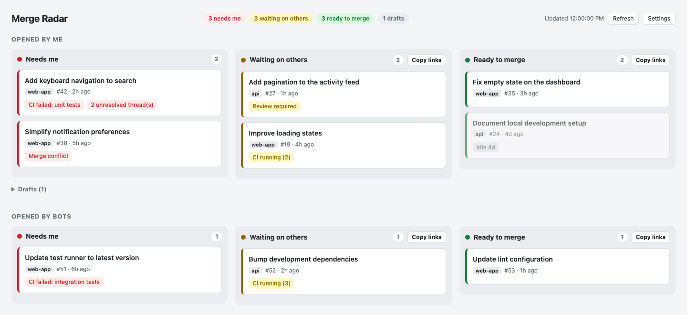

# Merge Radar

A local dashboard of your open GitHub pull requests, sorted by what is blocking each merge.



*Example dashboard with fictional repositories and pull requests.*

Merge Radar collects the PRs you authored or are assigned to and puts each one in a lane:

- **Needs me**: merge conflict, failed CI, unresolved review threads, or changes requested.
- **Waiting on others**: CI running, review required, or branch protection pending.
- **Ready to merge**: no blockers detected in the fetched data.
- **Drafts**: collapsed, out of the way.

PRs opened by bots (for example an automation app that assigns PRs to you) are shown in their own section. The "Opened by me" section includes all other results, including PRs authored by another person and assigned to you. Blockers link to the relevant GitHub page, with a direct link to a failing check or unresolved thread when available. Merge Radar never writes to GitHub.

## Requirements

- macOS or Linux
- Node.js 20 or later
- [GitHub CLI](https://cli.github.com/) logged in (`gh auth login`)

Merge Radar reuses your `gh` login and only reads data, so you don't need a new token or OAuth app.

## Run it

```bash
git clone https://github.com/JeremySomsouk/merge-radar.git
cd merge-radar
gh auth login
gh auth status
npm start
```

Open [localhost:4747](http://localhost:4747) in your browser. No `npm install` or build step is needed because the app uses only built-in Node.js modules. Stop the server with Ctrl+C.

Set `PORT` to use another port, for example `PORT=4848 npm start`. Run the tests with `npm test`.

## Run at login (macOS)

```bash
./install.sh     # installs a login agent and "Merge Radar.app" in ~/Applications
./uninstall.sh
```

Run these commands from the project folder after completing the setup above. Stop any manually started server on the same port first.

The agent keeps the server running in the background (logs go to `~/Library/Logs/merge-radar.log`). Open the dashboard with "Merge Radar" from Spotlight. Run `./install.sh` again if you move the project folder. The login installer is macOS-only; on Linux, start the server manually with `npm start`.

## Settings

The app works with the defaults immediately. To customize them, copy `config.example.json` to `config.json` (git-ignored), or click **Settings** in the page, which writes `config.json` for you. "Reset to defaults" copies the example file back.

| Setting | Default | Purpose |
| --- | --- | --- |
| Title keyword (`keyword`) | none | Only PRs whose title contains it, for example a team or ticket prefix |
| Extra GitHub filters (`extra`) | none | Any [search qualifiers](https://docs.github.com/en/search-github/searching-on-github/searching-issues-and-pull-requests), for example `repo:owner/repo -label:wip` |
| Ignored checks (`ignore`) | none | Comma-separated parts of check names that never count as blockers |
| First section (`first`: `mine` or `bot`) | Opened by me | Which section comes first |
| Refresh every (`minutes`) | 3 minutes | Auto refresh interval |
| Mark idle after (`idleDays`) | 3 days | PRs without updates for this long are faded and tagged |

Each lane in "Waiting on others" and "Ready to merge" has a **Copy links** button that copies a Markdown list of its PRs, ready to paste into a chat.

## Privacy

The server listens only on `127.0.0.1`. The browser loads its assets from the local server, and the server calls GitHub through your existing `gh` login. The app has no analytics or third-party scripts and does not save PR responses to disk. Settings are saved locally in `config.json`; GitHub CLI manages your credentials separately.

Local settings, session artifacts, environment files, keys, and logs are excluded by `.gitignore`. Keep organization names, team filters, and repository-specific settings in `config.json`; use generic values in `config.example.json`. Review screenshots and copied PR links before sharing them because they can contain private repository names and PR titles.

## Limitations and troubleshooting

- Each refresh fetches up to 50 authored and 50 assigned PRs, then removes duplicates. It reads up to 100 checks on the latest commit and 100 review threads per PR, without pagination.
- "Ready to merge" is advisory. Confirm the current checks, approvals, and repository rules on GitHub before merging. Ignored checks do not count as blockers in this dashboard.
- If authentication fails or a private repository is missing, run `gh auth status` and check that your CLI account has access, including any required organization SSO authorization.
- If the port is already in use, stop the existing server or set a different `PORT`. If the macOS login agent fails to start, check `~/Library/Logs/merge-radar.log` and rerun `./install.sh` with Node.js and `gh` available in your terminal.

## How it works

- `server.mjs` serves the page and `/api/prs`, which runs two `gh api graphql` searches (`author:@me` and `assignee:@me`).
- `lib.mjs` classifies each PR into a lane. It is pure and covered by `lib.test.mjs`.
- `index.html` is the whole UI, with no build step and no dependencies.

## License

[MIT](LICENSE)
